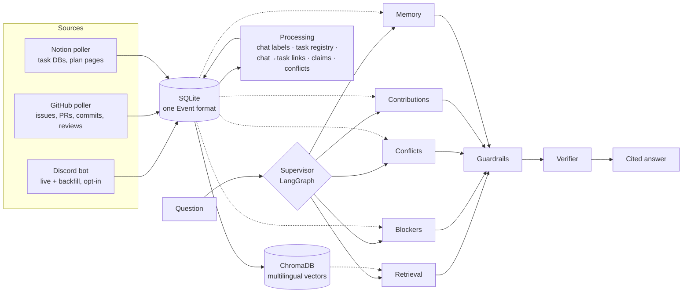

# TeamPulse

[](https://github.com/Siddhi-Karhekar/Tracker/actions/workflows/ci.yml)

**A multi-agent AI assistant and project manager for student project teams.** Teams plan and run their work in
TeamPulse (projects, tasks, a personal workspace for every member, a dashboard for the leader). TeamPulse also reads a team's **GitHub**, **Notion** and
**Discord**. It shows where they disagree, pulls blockers out of Hinglish chat, and builds fair,
evidence-based contribution reports. Every answer cites its sources. Everything runs on free tools and free AI
tiers.

> *"Login is marked Done in Notion, but GitHub issue #12 is still open and Riya said in chat yesterday that the
> OTP still isn't arriving."* That is the kind of thing TeamPulse puts at the top of the Home page.

---

## Contents

1. [What it does](#1-what-it-does)
2. [How it works](#2-how-it-works)
3. [Quick start (demo team, 10 minutes)](#3-quick-start-demo-team-10-minutes)
4. [Using the app](#4-using-the-app)
5. [Connecting your real team](#5-connecting-your-real-team)
6. [AI providers and free quotas](#6-ai-providers-and-free-quotas)
7. [The agents in detail](#7-the-agents-in-detail)
8. [Guardrails](#8-guardrails)
9. [Evaluation and testing](#9-evaluation-and-testing)
10. [Security and privacy](#10-security-and-privacy)
11. [Deployment and operations](#11-deployment-and-operations)
12. [Configuration reference](#12-configuration-reference)
13. [Project structure](#13-project-structure)
14. [Troubleshooting](#14-troubleshooting)
15. [Limitations and honest notes](#15-limitations-and-honest-notes)
16. [Status and next steps](#16-status-and-next-steps)

---

## 1. What it does

Student teams keep their plan in Notion, their code in GitHub and their real conversations in Discord, usually
in Hinglish. The three drift apart, and nobody has time to cross-check them. TeamPulse does it for them.

**Three headline features**

| Feature | What you get |
|---|---|
| **Conflict detection** | Where Notion, GitHub and chat disagree: status ("Done" vs open issue), owner (assigned to Kabir, Aman doing it), deadline (two different dates), stale plans ("Firebase" vs a chat decision for Postgres). Each finding cites both sides and suggests a fix. |
| **Blockers from Hinglish chat** | "OTP abhi bhi nahi aa raha", "canteen se data nahi mila", "re-review kar de" become *blocked*, *waiting for help* or *decision*, each linked to its task, marked open or resolved, with the replies that answer it. |
| **Fair contribution reports** | Per person: code, reviews, planning and docs, chat updates and **helping others**, with every chat claim ("80% done") checked against evidence. No rankings or scores. Opt-in, and each person approves their own report before the team sees it. |

**Project management (TeamPulse 2.0)**

- **My work**: each member's personal section shows what's overdue, due soon, blocked, high priority, in
  progress, under review and done, plus notifications and their deadline requests.
- **Project board**: projects, milestones, tasks with several assignees, subtasks, dependencies, comments and
  full history, as a board, a list, a calendar or a timeline. Workflow: Backlog → To do → In progress → Under
  review → Completed, plus Blocked. Deadline reminders arrive once a day.
- **Team dashboard** (leader): completion, workload per person (alphabetical, never ranked), at-risk work,
  and what needs a decision (finished work to approve, deadline requests).
- Members update their own tasks, report blockers, ask for a new deadline and comment. The leader plans,
  assigns, verifies progress and marks work Completed. **Self-reported progress** (with evidence links) is kept
  separate from **verified progress**, which only the leader sets. Completion % counts finished work by size.
- **Linked to GitHub and Notion**: each planned task shows its issue's commits, PRs and chat, and TeamPulse
  says where GitHub or Notion disagree with the plan ("Completed here, but GitHub still says open"). The plan
  is the source of truth; nothing changes by itself. Issues that aren't planned yet can be added in one click.
  Design, permission matrix and roadmap: [docs/TEAMPULSE_2.md](docs/TEAMPULSE_2.md).

**Also included**

- **Ask**: questions in English or Hinglish ("kya sab sync me hai?") with cited answers, a check that each
  statement matches its source, and the agent's step-by-step trace.
- **Team memory**: "remember that our final review is on 17 Nov". Remembered facts are re-checked against
  live data every time they're used.
- **Accounts and roles**: a team leader (full control) and team members (update their own tasks and comment;
  everything else read-only). Permissions are checked on the server.
- **Guardrails** on every AI answer, plus a full **evaluation suite** (per agent, RAGAS, LangSmith).

---

## 2. How it works



1. **Ingestion.** A Discord bot (only for members who opted in) and pollers for GitHub and Notion turn
   everything into one `Event` format in SQLite, each with a link back to the original. Edits and deletes are
   mirrored.
2. **Processing**, plain code with AI only where judgement is needed:
   - chat messages are grouped into conversations and labelled (blocker, help request, decision, progress or
     chat);
   - GitHub issues and Notion tasks are merged into one **task registry**;
   - chat messages are **linked to tasks**;
   - every source's view of each task (status, owner, deadline) becomes a **claim**;
   - rules turn disagreeing claims into **conflicts**.
3. **Answering.** The **Supervisor** (a LangGraph graph) rewrites follow-up questions and splits multi-part
   ones. It sends each part to a specialist agent, combines the answers, runs the **guardrails** and the
   **Verifier**, and attaches relevant team memory.
4. **App.** A Streamlit web app with sign-in, role-based pages, and every answer linked to its sources.

**Multi-agent, using the supervisor pattern.** One Supervisor routes questions to five specialists. The
Retrieval agent and the Supervisor are LangGraph graphs; the other specialists are Python classes the
Supervisor calls. It doesn't use LangChain chains or n8n.

**Tech stack (all free)**

| Layer | Tools |
|---|---|
| Agents | LangGraph (Supervisor and Retrieval graphs), plain Python specialists |
| AI models | Groq (`openai/gpt-oss-120b` by default), Google Gemini, or **Ollama** (local), with automatic fallback, caching and rate-limit handling |
| Search | ChromaDB (embedded) + FastEmbed `paraphrase-multilingual-MiniLM-L12-v2` (understands Hinglish ↔ English, ~0.2 GB, no PyTorch) |
| Storage | SQLite (WAL mode, one connection per thread) |
| App | Streamlit ≥ 1.50 |
| Sources | discord.py, GitHub REST API, Notion API |
| Evaluation | pytest, RAGAS 0.4, LangSmith, Arize Phoenix (optional tracing) |
| CI | GitHub Actions: tests on Linux (Python 3.12 and 3.13) and Windows, lint, dependency scan, RAGAS wiring |

---

## 3. Quick start (demo team, 10 minutes)

Needs **Python 3.12 or 3.13** and Git.

**Windows (PowerShell)**

```powershell
git clone https://github.com/Siddhi-Karhekar/Tracker.git
cd Tracker
python -m venv .venv
Set-ExecutionPolicy -Scope Process Bypass      # lets this window run the activation script
.venv\Scripts\Activate.ps1                     # the prompt now starts with (.venv)
python -m pip install -r requirements.lock
copy .env.example .env
python -m teampulse.seed_demo                  # builds the demo team; prints two sign-ins
streamlit run app.py
```

**macOS / Linux**

```bash
git clone https://github.com/Siddhi-Karhekar/Tracker.git && cd Tracker
python3 -m venv .venv && source .venv/bin/activate
pip install -r requirements.lock
cp .env.example .env
python -m teampulse.seed_demo
streamlit run app.py
```

Then:

1. **Add one free AI key** to `.env` (open it with `notepad .env` on Windows):
   - Groq: https://console.groq.com/keys → `GROQ_API_KEY=...`
   - or Gemini: https://aistudio.google.com/apikey → `GEMINI_API_KEY=...`
   - or install Ollama and `ollama pull qwen2.5:7b` (local, private, no key needed).

   Without any key, TeamPulse still works using its rule-based fallbacks; the answers are just plainer.
2. **Sign in** with the details `seed_demo` printed: **Neha** (team leader, sees everything) or **Kabir**
   (team member, read-only).
3. **Try:** Home → Conflicts → Blockers → Tasks → Contributions. In **Ask**, try "kya sab sync me hai?",
   "who is really doing payments?" and "remember that our demo day is on 2 Dec".

The first start downloads the search model once (~0.2 GB). Every new terminal window needs the environment
activated again (`.venv\Scripts\Activate.ps1`). If you see `No module named 'requests_toolbelt'`, the
environment isn't active.

### The demo team: "CampusEats"

A canteen pre-order app built by **Riya** (frontend), **Aman** (backend), **Kabir** (payments + ML) and
**Neha** (PM). The data hides these problems on purpose; the answer key is in `data/demo_answer_key.json`:

| Planted problem | Evidence |
|---|---|
| Login marked **Done** in Notion | GitHub #12 still open; Discord: "OTP abhi bhi nahi aa raha" |
| Menu API **In progress** in Notion | PR #15 merged, #14 closed |
| Payments assigned to Kabir | Aman's commits and Aman in chat: "payment main kar raha hu" |
| Payments deadline differs | Notion due date vs GitHub milestone M2 |
| Plan says Firebase | Discord decision: Postgres |
| Hidden blockers | OTP mails in spam; no canteen data for the ML model (Neha replies she's on it) |
| An unproven claim | Kabir: "recommendation model almost 80% done", with one notebook commit days earlier |

---

## 4. Using the app

| Page | What it shows |
|---|---|
| **My work** | Your personal workspace: counts, notifications, Focus (overdue, blocked, due soon, high priority), all your tasks, your deadline requests. Leaders can open anyone's |
| **Project board** | Board and list of a project's tasks with filters; open a task to update it, tick subtasks, report a blocker, ask for a new deadline or comment. Leaders create projects, milestones and tasks here |
| **Team dashboard** (leader) | Completion, workload, at-risk tasks, work to approve, deadline requests, milestones, activity |
| **Home** | The single most important issue in plain words, a needs-attention list, recent activity, and the **sync strip**: each task with what GitHub, Notion and chat say |
| **Ask** | Chat with cited answers, a "statements match their sources" check, guardrail notes and the agent trace |
| **Blockers** | What people are stuck on or waiting for, linked to tasks, with open / resolved / possibly resolved |
| **Conflicts** | Where sources disagree, both sides linked, severity, suggested fix; leaders mark real / false alarm |
| **Source tasks** | Every GitHub issue / Notion task's status / owner / deadline per source; leaders correct chat→task links |
| **Contributions** | Evidence-based reports; each member reviews, adds context and approves their own |
| **Team & access** (leader) | Create accounts, one-time passwords, reset or deactivate, choose what members see, activity log |
| **Data sources** (leader) | Freshness, whether the poller and bot are running, connection check with exact fixes, AI test |
| **Team memory** | Remembered facts, checked against live data |
| **Label chat** (leader) | Label messages by hand to measure the classifier on your own data |
| **My account** | Choose your password, sign out of other devices |

### Accounts and roles

There is no sign-up page: the **team leader** creates every account.

1. Create the first leader on the computer running TeamPulse:
   `python -m teampulse.auth create-leader --name "Your Name"` (it prints a one-time password).
   On Streamlit Cloud, set a 16+ character `TEAMPULSE_SETUP_CODE` instead and create the leader from the
   sign-in page, then remove the code.
2. Sign in and choose your own password.
3. **Team & access → Add a teammate.** TeamPulse shows a one-time password **once**; hand it over privately.
   Link each account to the person in the team data so they can review their own report.

| | Team leader | Team member |
|---|---|---|
| View pages and ask questions | All pages | My work, Project board, and the pages the leader allows |
| Plan: projects, tasks, assignments, deadlines, mark Completed | ✅ | ❌ |
| Own tasks: status (up to Under review), progress, subtasks, blockers, deadline requests | ✅ | ✅ |
| Comment on any task | ✅ | ✅ |
| Accounts, data refresh, verdicts, labels, memory, settings | ✅ | ❌ |
| Approve or dispute **own** contribution report | ✅ | ✅ (switch off with `TEAMPULSE_CONTRIB_REVIEW=off`) |

The full project-management permission matrix is in [docs/TEAMPULSE_2.md](docs/TEAMPULSE_2.md#4-permission-matrix).
Roles are enforced on the server for every action. Hiding a page also hides it from the Ask chat. More in
[SECURITY.md](SECURITY.md).

---

## 5. Connecting your real team

Set `TEAMPULSE_DB=data/teampulse.db` in `.env`, then set up the sources you use.

**Discord bot**

1. https://discord.com/developers/applications → **New Application** → **Bot** tab → **Reset Token** →
   copy into `DISCORD_BOT_TOKEN`. Turn on **Message Content Intent**.
2. **OAuth2 → URL Generator**: scope `bot`; permissions *View Channels*, *Read Message History*,
   *Send Messages*. Open the URL and add the bot to your server.
3. Discord settings → Advanced → Developer Mode. Right-click the server → **Copy Server ID** →
   `DISCORD_GUILD_ID`.
4. Each teammate types `!teampulse join`.

Nothing is stored for anyone who hasn't joined. `!teampulse leave` deletes everything stored from that person,
including derived copies.

**GitHub**: a fine-grained token for just your repo with read-only *Contents*, *Issues*, *Pull requests* and
*Metadata*. Set `GITHUB_TOKEN` and `GITHUB_REPOS=owner/repo`.

**Notion**: create an internal integration at https://www.notion.so/profile/integrations, then share the task
database and plan pages with it (**••• → Connections**). Set `NOTION_TOKEN`, plus `NOTION_DATABASE_IDS` /
`NOTION_PAGE_IDS` (the 32-character IDs from the URLs).

**Run three processes**

```bash
python -m teampulse.ingest.discord_bot          # live chat capture
python -m teampulse.ingest.poll --scan-chat     # GitHub + Notion + processing, every 5 minutes
streamlit run app.py                            # the app
```

Then open **Data sources → Run check** (or `python -m teampulse.health`). It signs in to each service
read-only and tells you exactly what to fix: a wrong token, a repo the token can't see, an unshared Notion
database, a missing Discord intent. To record which accounts belong to the same person:
`python -m teampulse.cli link --name Riya --discord <id> --github riya-dev --notion <user-id>`.

---

## 6. AI providers and free quotas

`LLM_PROVIDERS=groq,gemini,ollama` sets the order to try. If one fails, the next is used, and every answer is
cached in SQLite, so repeated questions cost nothing.

| Provider | Default model | Notes |
|---|---|---|
| Groq | `openai/gpt-oss-120b` | Fast. Free tier: 200,000 tokens/day **per model**. `openai/gpt-oss-20b` has its own separate quota. |
| Gemini | `gemini-3.8-flash` | Free tier allows only a few requests per minute; set `TEAMPULSE_LLM_MIN_INTERVAL=7` |
| Ollama | `qwen2.5:7b` | Local and private, unlimited. Needs ~8 GB RAM and a 4.7 GB download. **Use this for real team data.** |

How TeamPulse handles free tiers:
- A **wrong key or retired model** is reported once, with what to set in `.env`, then skipped. (Groq retired
  `llama-3.3-70b-versatile` in August 2026.)
- A **used-up daily quota** is reported once and skipped for the rest of the run.
- A **per-minute limit or overloaded server** (429/503) is waited out once, using the provider's suggested
  delay (up to 60 s).
- Every reply is capped (`TEAMPULSE_LLM_MAX_TOKENS`). Model quirks are cleaned up: citations like `【3】`
  become `[3]`, and special hyphens become normal ones.
- **Every AI step has a fallback** (keyword classifier, rules, templates), so the app keeps working with no AI
  at all.

> Free hosted tiers may use prompts for training. For a real team's chat, use `LLM_PROVIDERS=ollama`.

---

## 7. The agents in detail

### Supervisor (`agents/supervisor.py`)
1. **Route** (AI, JSON): rewrites follow-ups into standalone questions ("and who owns it?" → "Who owns the
   payments task?"). Splits multi-part questions into up to 3 parts and picks a specialist for each. If the
   AI is unavailable, a Hinglish-aware keyword router takes over ("atke" → blockers, "sync" → conflicts,
   "ne kya kiya" → contributions).
2. **Run specialists** one at a time (kinder to free-tier limits). Specialists behind pages the person can't
   open are refused here, after routing, so wording a question cleverly can't get round it.
3. **Combine**: one part → that answer; several → evidence merged, citations renumbered, one combined answer.
4. **Guardrails**, then the **Verifier**, then relevant **team memory** (re-checked against live data).

### Retrieval (`agents/retrieval.py`), a LangGraph graph
`plan` (AI: 1–4 search queries, including a Hinglish phrasing; sources; time window) → `retrieve`
(semantic search plus time-window activity, **plus direct replies to any chat message found**) → `answer`
(AI, from numbered evidence only, `[n]` after every statement) → `check_citations` (removes citations to
evidence that doesn't exist).

### Blockers (`agents/blockers.py`, `signals.py`)
Chat is grouped into conversations (same channel, gaps under 45 minutes) and labelled in batches of about 30
messages per AI call: blocker, help request, decision, progress or chat. Social questions like "lunch?" count
as chat. Each item gets its linked task's current state, its **direct replies** ("main ma'am se baat kar
rahi hu"), and a status: open, resolved in chat, or possibly resolved (task closed afterwards).

### Tasks, linking and claims (`tasks.py`, `claims.py`)
- **Registry:** every GitHub issue is a task. A Notion task joins it by `#12`, a near-identical title, or AI
  confirmation; otherwise it's a Notion-only task.
- **Chat → task linking:** an exact `#12` wins. Otherwise a shortlist of up to 5 tasks is built, first those
  sharing a word with the message ("report", "deploy"), then by meaning. The AI names the task **by its
  title**, which must be in that message's list; this avoids the AI picking the wrong letter. Human
  corrections on the Tasks page always win.
- **Claims:** every source's status, owner and deadline for each task (e.g. chat "M2 tak" → milestone M2's date).

### Conflicts (`discrepancies.py`, `agents/discrepancy.py`)
Plain rules over the claims (reliable and testable):

| Type | Fires when |
|---|---|
| status | Notion says done but the GitHub issue is open and/or chat reports a problem (and variants) |
| stale_plan | GitHub shows it done (closed issue / merged PR) but Notion doesn't |
| owner | the assigned people aren't the ones doing the work, or GitHub and Notion disagree |
| deadline | sources give dates ≥ 2 days apart and the task isn't finished |
| plan_outdated | a chat decision made after the plan page was edited contradicts it (AI check) |

Findings have stable IDs. Ones that disappear are marked resolved; ones marked false alarm stay dismissed until
the values change. The agent explains them citing both sides, and **can't drop a detected conflict**: any the
AI leaves out are added back from the data.

### Contributions (`contributions.py`, `agents/contributions.py`)
Evidence per person in five groups: Code, Reviews & discussion, Planning & docs, Team chat, **Helping
others**. Chat claims are checked against the person's own work on that task:
- **supported**: matching evidence within 3 days
- **older evidence only**: e.g. "80% done" with one commit days before
- **no linked evidence found (may be offline work)**: never "false"
- **not linked to a task**

Built-in ethics: no scores or rankings, opt-in only, each person approves their own report first, and
neutral wording enforced by both the prompt and a guardrail.

### Memory (`memory.py`)
Only stores what someone explicitly asks it to remember ("remember that…", "yaad rakhna ki…"). A newer fact
on the same topic replaces the older one, and "forget …" removes one. Only leaders can change memory; members
can ask what's remembered.

### Verifier (`verifier.py`)
Splits each answer into statements and has an AI judge check each one against the **full source it cites**,
the same way the agent saw it (text plus status, author, assignees and dates). Results: supported, partial or
unsupported. Unsupported statements are shown as a warning. Without AI, a rough word-overlap check is used and
labelled as such.

---

## 8. Guardrails

`teampulse/guardrails.py` checks every specialist's answer, and the combined one, **on the server before
anyone sees it**. The checks never ask the AI to judge itself.

| Guardrail | Agents | Action |
|---|---|---|
| `secret_leak` (API keys, tokens) | all | removed |
| `invented_link` (links not among the sources) | all | removed |
| `invented_contact` (emails, phone numbers not in the sources) | all | removed |
| `too_long` | all | cut |
| `prompt_leak` (answer repeats TeamPulse's instructions) | all | answer replaced |
| `ungrounded_reference` (an #issue, %, date or amount found in no source) | retrieval, blockers, conflicts, contributions, combined | warning |
| `uncited_blocker` | blockers | warning |
| `one_sided_conflict` (fewer than two sources cited) | conflicts | warning |
| `judgemental_language` ("lazy", "lied", ranking, "kaamchor"…) | contributions, combined | replaced by the rule-based report |
| `withheld_member` (work of someone who hasn't opted in or approved) | contributions, combined | replaced |

Also: every system prompt tells the model to treat chat and issues as data, never as instructions. Links the
AI writes are shown as "label (address)", so a phishing link can't hide behind friendly text. Hostile HTML
and Markdown from any source are escaped on every page.

---

## 9. Evaluation and testing

### Automated tests
`python -m pytest -q` runs **242 offline tests** (no keys, no internet). They cover agents, guardrail
attacks, both roles through the real pages, XSS on every page, concurrency, privacy deletion, backups, and a
regression test for every bug found by real AI runs, and project management (permissions per role and per
assignee, workflow rules, two people editing at once, both roles through the pages). A Playwright test runs the
whole assign → update → review workflow in real Chromium (`TEAMPULSE_E2E=1 python -m pytest tests/e2e`). CI runs them on every push: Linux (Python 3.12 and
3.13), Windows, the browser test, lint, dependency scan, and the RAGAS wiring check.

### Per-agent evaluation
Each agent is tested on its own job against the demo answer key, with a threshold per metric
(`eval_data/agent_thresholds.json`):

```bash
python -m teampulse.eval.agents --offline --check   # no AI; regression floors (CI)
python -m teampulse.eval.agents                     # with AI: the real system
python -m teampulse.eval.agents --only linking,end_to_end   # just some agents
```

The evaluation checks the AI providers first. It stops if no provider is working, and marks any step that
fell back to rules with ⚠️ "Not a valid AI result", so a used-up quota can't pass for an AI result.

**Latest results:** Groq `openai/gpt-oss-20b`, real multilingual search model, demo team, 30 Oct 2026.

| Agent | Metric | Result | Target |
|---|---|---|---|
| Router | accuracy (26 questions) | 100% | ≥ 90% |
| Retrieval | context recall | 100% | ≥ 80% |
| Blockers | chat classifier macro-F1 (60 Hinglish messages) | 73% | ≥ 70% |
| Blockers | detection recall / precision | 100% / 100% | 100% / ≥ 80% |
| Linking | chat → task accuracy | 80% | ≥ 80% |
| Conflicts | recall / precision (5 planted) | 100% / 100% | 100% / ≥ 80% |
| Contributions | claim verdicts, withheld reports, neutral wording | 100% | 100% |
| Memory | remember / recall / replace / forget / refuse members | 80% → see note | 100% |
| Verifier | accuracy on labelled statements | 100% | ≥ 88% |
| Guardrails | attacks caught / false alarms | 100% / 0% | 100% / 0% |
| **End to end** (18 questions) | pass rate · correctness · citation recall · faithfulness | **94% · 98% · 94% · 93%** | ≥ 75% · – · ≥ 75% · ≥ 80% |

Router, retrieval and conflicts were measured on `gpt-oss-120b` earlier the same day. Memory scored 80% in
that run only because the check was too strict (the agent stored "December 5", the check expected "5 Dec");
the check was fixed but not yet re-run with AI. Run the full suite once on `gpt-oss-120b` for final report
numbers.

**What the evaluation found and fixed** (each now has a regression test):

| Found in a real AI run | Fix |
|---|---|
| Faithfulness 55%: the judge never saw a source's status, author or dates | Verifier and RAGAS see the full source, as the agent did (→ 93%) |
| Groq's model wrote `【1】` citations and `2026‑11‑17` with special hyphens | All AI output normalised |
| Linking 20%: the AI picked "B" when the right task was "A"; the right task sometimes wasn't offered | Answer by title; word-overlap shortlist (→ 80%) |
| Conflict answers silently dropped detected conflicts | Missing conflicts are added back from the data |
| "lunch?" labelled as a help request | Classifier prompt: social questions are chat (precision 57% → 100%) |
| "Who helped with Kabir's data problem?" answered "no one" | Retrieval and Blockers follow reply threads |
| Retired model, used-up quotas and busy servers handled badly | Clear errors, skip or wait, and runs never pass on fallback rules |

### RAGAS
Faithfulness, context precision, context recall and factual correctness, with a free AI as the judge. RAGAS
needs older packages, so it runs in its own environment and scores the file the agent evaluation writes:

```bash
python -m venv .venv-eval
.venv-eval/bin/pip install -r requirements-eval.txt           # Windows: .venv-eval\Scripts\pip
.venv-eval/bin/python -m teampulse.eval.ragas_score data/eval/agents-<time>-ragas.jsonl --judge groq
```

### LangSmith
The free Developer plan has 1 seat, 5,000 traces a month and 14-day retention. Add `LANGSMITH_API_KEY` to
`.env`, then:

```bash
python -m teampulse.eval.langsmith_eval          # 18 golden questions as a dataset; each run an experiment
python -m teampulse.eval.agents --langsmith      # same, with per-agent metrics attached
```

`LANGSMITH_TRACING=true` also sends live traces of every question. Traces contain chat text, so use the demo
team or get your team's agreement. Runs without a key are tested to make no network calls.

### More evaluations
- `python -m teampulse.eval.run_all`: chat classifier (keyword vs AI), linking (refs vs similarity vs AI),
  conflicts (rules vs rules + AI), and **plain RAG vs single agent vs multi-agent** on the 18 questions.
- **Your own team's numbers:** label ~300 real messages on **Label chat**, correct links on **Tasks** and
  give verdicts on **Conflicts**. Then `python -m teampulse.eval.blockers --data db`,
  `python -m teampulse.eval.linking` and `python -m teampulse.eval.discrepancies` report on your data.

---

## 10. Security and privacy

- Passwords are salted scrypt hashes. One-time passwords are shown once and never stored.
- Session tokens are random, stored only as hashes, and expire after 60 idle minutes or 12 hours. Signing out,
  deactivation or a reset ends them at once.
- Permission checks run on the server for every change (`actions.py`), and hiding a page also blocks it in the
  Ask chat.
- Sign-in, setup code and password changes are rate-limited atomically, so parallel guessing can't dodge the
  lockout.
- Every page escapes hostile HTML and Markdown from sources; only `http(s)` links are allowed; stack traces
  are never shown.
- Discord is opt-in. Leaving deletes the person's messages and every derived copy. Retention limits apply to
  logs and the AI cache.
- The audit log records sign-ins, changes and refused attempts, never passwords or message text.

Full details: [SECURITY.md](SECURITY.md) (both pre-launch checklists) and [AUDIT.md](AUDIT.md) (findings,
fixes, deployment checklist, open risks).

---

## 11. Deployment and operations

**Free public demo on Streamlit Community Cloud**

1. https://share.streamlit.io → **Create app** → this repo, branch `main`, file `app.py`.
2. **Advanced settings → Secrets**:
   ```toml
   TEAMPULSE_PUBLIC_DEMO = "on"
   TEAMPULSE_DB = "data/demo.db"
   LLM_PROVIDERS = "groq,gemini"
   GROQ_API_KEY = "your key"
   TEAMPULSE_DEMO_QUESTION_LIMIT = "15"
   ```
3. Deploy. Public demo mode uses only the fictional team and resets it daily. It has one-click "Explore as
   Neha / Kabir" buttons, limits questions per visitor, and switches off account and settings changes so one
   visitor can't change things for everyone. **Never deploy a real team's database publicly.**

Apps sleep after 12 hours without visitors, so open yours a few minutes before you present.

**Running for a real team:** follow the checklist in [AUDIT.md](AUDIT.md#e-production-deployment-checklist):
HTTPS (Streamlit Cloud, or a reverse proxy such as Caddy), exact versions from `requirements.lock`, three
supervised processes, monitoring and backups. Day to day:

```bash
python -m teampulse.health status        # are the poller and bot alive? exit code 1 if not
python -m teampulse.maintenance backup   # verified copy (the poll loop backs up daily if TEAMPULSE_BACKUP_DIR is set)
python -m teampulse.maintenance restore data/backups/teampulse-<time>.db --yes   # stop everything first
python -m teampulse.auth reset <username>   # if a leader is locked out
```

---

## 12. Configuration reference

All settings live in `.env` (copy `.env.example`). Only an AI key is needed for the demo.

| Group | Setting | Default | Purpose |
|---|---|---|---|
| Data | `TEAMPULSE_DB` | `data/demo.db` | Database file |
| AI | `LLM_PROVIDERS` | `groq,gemini,ollama` | Order to try |
| | `GROQ_API_KEY` / `GROQ_MODEL` | – / `openai/gpt-oss-120b` | Groq |
| | `GEMINI_API_KEY` / `GEMINI_MODEL` | – / `gemini-3.8-flash` | Gemini |
| | `OLLAMA_URL` / `OLLAMA_MODEL` | `http://localhost:11434` / `qwen2.5:7b` | Local Ollama |
| | `TEAMPULSE_LLM_MIN_INTERVAL` | `0` | Seconds between AI calls (7 for Gemini's free tier) |
| | `TEAMPULSE_LLM_MAX_TOKENS` | `1500` | Longest AI reply |
| | `TEAMPULSE_VERIFY` | `on` | Verifier on/off |
| Search | `TEAMPULSE_EMBEDDER` | multilingual MiniLM (FastEmbed) | `hash` = offline, no download (tests) |
| | `TEAMPULSE_LINK_THRESHOLD` | per model | Minimum similarity for automatic links |
| Sources | `DISCORD_BOT_TOKEN`, `DISCORD_GUILD_ID`, `DISCORD_BACKFILL_DAYS` | | Discord |
| | `GITHUB_TOKEN`, `GITHUB_REPOS`, `GITHUB_BACKFILL_DAYS` | | GitHub |
| | `NOTION_TOKEN`, `NOTION_DATABASE_IDS`, `NOTION_PAGE_IDS`, `NOTION_PROP_*` | | Notion |
| | `POLL_MINUTES` | `5` | Poll interval |
| Accounts | `TEAMPULSE_AUTH` | `on` | `off` only for local development |
| | `TEAMPULSE_SETUP_CODE` | – | First-leader setup from the sign-in page (16+ chars; remove after) |
| | `TEAMPULSE_SESSION_HOURS` / `TEAMPULSE_IDLE_MINUTES` | `12` / `60` | Session limits |
| | `TEAMPULSE_ASK_PER_HOUR` | `60` | Questions per person per hour |
| | `TEAMPULSE_CONTRIB_REVIEW` | `on` | Members approve their own report |
| Demo | `TEAMPULSE_PUBLIC_DEMO` / `TEAMPULSE_DEMO_QUESTION_LIMIT` | `off` / `15` | Public demo mode |
| Retention | `TEAMPULSE_AUDIT_DAYS` / `TEAMPULSE_CACHE_DAYS` | `180` / `30` | Activity log / AI cache |
| Backups | `TEAMPULSE_BACKUP_DIR` / `TEAMPULSE_BACKUP_KEEP` | – / `14` | Daily backups from the poll loop |
| Tracing | `TEAMPULSE_TRACING`, `PHOENIX_COLLECTOR_ENDPOINT` | `off` | Arize Phoenix (local) |
| | `LANGSMITH_API_KEY` / `LANGSMITH_TRACING` | – / `false` | LangSmith experiments / live traces |

---

## 13. Project structure

```
app.py                      navigation; shows only the pages your role allows
views/                      one file per page (home, ask, workspace, board, dashboard, blockers,
                            discrepancies, tasks, contributions, team, sources, memory, label, login, account)
teampulse/
  models.py                 Event: the one format every source becomes
  db.py                     SQLite schema, per-thread connections, deletion with derived copies, heartbeats
  config.py                 reads .env
  llm.py                    Groq / Gemini / Ollama: fallback, cache, retries, quotas, output clean-up
  index.py                  ChromaDB + FastEmbed multilingual search
  signals.py                chat scanner: conversations → labels → task links
  tasks.py                  task registry, chat → task linking
  claims.py                 status / owner / deadline claims per source
  discrepancies.py          conflict rules and tracking
  contributions.py          evidence-based reports, claim checks, opt-in + self-review
  memory.py                 remember / forget / recall, verified against live data
  verifier.py               checks each cited statement against its source
  guardrails.py             output checks on every answer
  agents/                   supervisor, retrieval, blockers, discrepancy, contributions, baseline (plain RAG)
  auth.py, actions.py       accounts, sessions, roles; the only write path (server-side checks)
  pm.py, pm_ui.py           project management: rules and permission checks; task cards and task panel
  pm_sync.py                planned tasks ↔ GitHub issues / Notion pages: evidence, disagreements, import
  ui.py, webapp.py          design system, shared page helpers, public demo mode
  health.py                 connection checks and process status
  maintenance.py            retention purge, verified backup and restore
  http.py, tracing.py       retrying HTTP sessions; Phoenix / LangSmith tracing
  ingest/                   discord_bot, github_poller, notion_poller, poll (loop)
  eval/                     agents, qa, blockers, linking, discrepancies, ragas_score, langsmith_eval, run_all
  seed_demo.py              the CampusEats demo team + answer key
eval_data/                  18 golden questions (with reference answers), 60 Hinglish messages,
                            agent cases, thresholds
docs/TEAMPULSE_2.md         project management: decisions, MCP assessment, permissions, data model, roadmap
tests/                      242 offline tests, plus tests/e2e (real browser) (+ tests/eval_env for the RAGAS environment)
requirements.txt            direct dependencies
requirements.lock           exact tested versions for every OS (install this)
requirements-eval.txt       RAGAS environment
SECURITY.md · AUDIT.md      security design and checklists · production-readiness audit
.github/workflows/ci.yml    CI
```

---

## 14. Troubleshooting

| You see | Fix |
|---|---|
| `No module named 'requests_toolbelt'` (paths under `AppData\Roaming\Python`) | The environment isn't active: `Set-ExecutionPolicy -Scope Process Bypass`, then `.venv\Scripts\Activate.ps1` |
| `running scripts is disabled on this system` | `Set-ExecutionPolicy -Scope Process Bypass` first |
| `NO groq ... model ... isn't available` (404) | Set `GROQ_MODEL` to a current model (see console.groq.com/docs/models) |
| `daily free quota for this model is used up` | Wait for the reset, set `GROQ_MODEL=openai/gpt-oss-20b` (own quota), or add a Gemini key |
| `gemini ... 429` | Free tier per-minute limit: `TEAMPULSE_LLM_MIN_INTERVAL=7` |
| `NO ollama ... qwen2.5:7b` | `ollama pull qwen2.5:7b`, or remove `ollama` from `LLM_PROVIDERS` |
| "Not a valid AI result" in an evaluation | Some AI calls failed; rerun the listed steps with `--only ...` once a provider works |
| Data sources says "Not running" | Start `python -m teampulse.ingest.poll --scan-chat` / the Discord bot |
| Signed out after refreshing the page | Expected: sessions are kept on the server, not in the browser |

---

## 15. Limitations and honest notes

- **The demo is small and synthetic** (4 people, 41 items, 18 questions), and its data and the rules were
  written together. Demo scores show the system works and compare methods; real-world accuracy needs your
  team's labels and verdicts.
- **Not yet run against live GitHub, Notion and Discord accounts.** All three integrations are built and
  tested offline. Use **Data sources → Run check** when connecting.
- **Correctness is keyword-based**: an answer can be right in words the checker doesn't expect. RAGAS and the
  LangSmith experiments give a second view.
- **Free tiers:** quotas run out (one full evaluation is a large share of Groq's daily 200k tokens), and
  hosted tiers may train on prompts. Use Ollama for real data.
- Notion's API reports only a page's **last** editor, so earlier editors aren't credited.
- Streamlit can't send its own security headers. Self-hosting behind a reverse proxy adds them.
- The board has no drag-and-drop (Streamlit doesn't support it natively); status changes go through the task
  panel. Notifications are in the app only, with no email yet. One `@leaders` inbox is shared by all leaders.
- Refreshing the browser tab signs you out, a deliberate trade-off to keep session tokens off the browser.

---

## 16. Status and next steps

**Built:** project management phase 1 (projects, tasks, My work, board, leader dashboard, permissions);
ingestion from all three sources; five specialist agents and the Supervisor; Verifier; guardrails;
the full web app with accounts and roles; security hardening and audit; per-agent evaluation with RAGAS and
LangSmith; CI on Linux and Windows.

**Next:**
1. Project management phases 2–5: calendar and timeline views, GitHub/Notion sync for planned tasks, the AI
   project manager (it proposes and the leader confirms), and proactive monitoring
   ([roadmap](docs/TEAMPULSE_2.md#7-roadmap-later-rounds)).
2. One full evaluation on `gpt-oss-120b` for the report (`python -m teampulse.eval.agents` +
   `python -m teampulse.eval.langsmith_eval`).
3. Connect your real team (ideally with Ollama) and run it for 2–3 weeks.
4. Label ~300 messages, correct ~100 links and give verdicts on conflicts. These give the real-world numbers.
5. Deploy the public demo and record a backup demo video.
