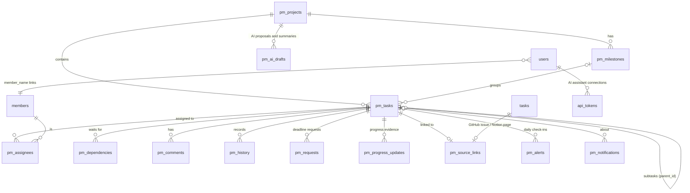

# TeamPulse 2.0: project management

TeamPulse 1.x watched a team's GitHub, Notion and Discord. TeamPulse 2.0 also lets the team **plan and run
the work inside TeamPulse**: projects, tasks, subtasks, dependencies, milestones, comments, deadline requests,
a personal workspace for every member and a dashboard for the team leader.

This document covers the decisions behind it, what phase 1 delivers, and the plan for the rest.

---

## 1. Decision: extend the current app, don't rewrite it

The spec asked whether to move to a new stack (for example FastAPI + React + PostgreSQL). We extended the
existing Streamlit + SQLite app instead.

| | Extend (chosen) | Rewrite (FastAPI + React + Postgres) |
|---|---|---|
| Existing features (conflicts, Hinglish blockers, contributions, Ask, guardrails, evaluation) | Keep working, already tested (191 tests) | Re-implemented or wrapped; weeks of risk |
| Security already audited (sessions, RBAC, rate limits, audit log, XSS) | Reused as-is | Rebuilt and re-audited |
| Cost | Free: Streamlit Community Cloud, one SQLite file | Needs hosting for an API, a frontend and a database |
| Team size it serves | 3–8 students, low concurrency | Hundreds of users |
| Drag-and-drop Kanban, real-time updates | Not native (status changes through a form; pages refresh on every action) | Native |
| Time to first usable version | One round | Several rounds before parity |

**Why this is enough.** Student teams are small. SQLite in WAL mode handles their write volume comfortably,
and the code already uses one connection per thread with a 15-second busy timeout. Every new write is a short
transaction. Two people editing the same task can't overwrite each other silently: each task carries a
`version`, and a save based on an old version is refused with "Someone else changed this task… reload".

**When to revisit.** Move to PostgreSQL (and a separate API) if TeamPulse ever hosts many teams in one
deployment, needs live collaborative editing, or outgrows one machine. All database access for project
management goes through `teampulse/pm.py`, so that move would touch one module.

## 2. MCP assessment

The Model Context Protocol (MCP) lets an AI assistant call tools on a server. We looked at it in two directions.

- **TeamPulse as an MCP client** (reading GitHub, Notion and Discord through their MCP servers instead of their
  REST APIs). Not worth it now. The pollers already work, are tested offline, retry on failure and respect
  consent. MCP would add a moving part without new data.
- **TeamPulse as an MCP server** (letting Claude Desktop or another assistant ask "what's blocked?" or "what's
  on my plate?"). Useful later. It would expose the same read functions the pages use (`pm.workspace`,
  `pm.dashboard`, the Ask supervisor) behind the same permission checks, with a per-user token. That fits
  phase 4, together with the AI project manager, and is listed there.

Decision: no MCP in phase 1. The functions an MCP server would call are designed for it: each takes the
signed-in person and checks permission itself.

**Update (round 5): TeamPulse is now an MCP server** (`python -m teampulse.mcp_server`), built on the official
Python SDK (`mcp` 2.x).

- **Tools:**
  - 6 read tools: my tasks, what next, a task with its GitHub/Notion evidence, search, project status,
    notifications
  - 5 write tools, limited to the person's own work: comment, report progress, report a blocker, send for review,
    and (leaders) propose tasks as a draft
- **Access:** each person creates a token on My account, read-only or read and update.
- **Permissions:** the same checks as the pages run on every call.
- **Not exposed:** assigning, deadlines, approving, completing and deleting.

TeamPulse as an MCP **client** is still not worth it, for the reasons above.

## 3. What phase 1 delivers

**Projects and milestones.** The leader creates projects with dates and milestones.

**Tasks.** Each has a title, description, project, milestone, one or more assignees, the creator, priority
(low, medium, high, urgent), status, created / start / deadline / completed dates, an estimate in hours,
subtasks (one level), dependencies on other tasks in the project, comments and a full change history.
Archiving removes a task from every view but keeps its history.

**Workflow.** Backlog → To do → In progress → Under review → Completed, with Blocked available from any
state. The rules are enforced on the server:

- A task can't be started, sent for review or completed while a task it **waits for** is unfinished.
- **Blocked** needs a reason. The reason is saved as a blocker comment and the leader is notified.
- **Completed** is the leader's call. Members send finished work to Under review; the leader approves it or
  sends it back with a note. A task with open subtasks can't be completed.
- Only the leader can reopen completed work.

**Three progress numbers, kept apart.**

- **Self-reported**: the assignee's own number. Each update can say what they did and link to evidence (a PR,
  commit, doc or design; only `https://` links are accepted).
- **Subtasks done**: counted, not estimated.
- **Verified**: set only by the team leader after looking at the work. Approving a task in review sets it to
  100%; reopening clears it. Nothing automatic, and no AI, ever writes a verified number.

A task is flagged when the reported number runs 40 points or more ahead of the verified one (or of the
subtask count, if nothing has been verified yet): "reported 80% but the leader verified 40%". The flag
describes the work, never the person.

**Completion %** counts finished tasks by **size** (1, 2, 3, 5 or 8, set by the leader). A task counts only
once the leader has marked it Completed, and reported percentages are never averaged. The pages explain this
next to the number, for the project, each milestone and each person's workspace.

**Calendar and timeline.** The project board and each person's workspace have a month calendar of deadlines,
with milestones on the project calendar. The board also has a timeline: a bar from each task's start date to its
deadline, coloured by status, with lines for today and the milestones.

**Deadline reminders.** Each assignee is reminded once a day about work due today or tomorrow, and about overdue
work. The leaders are told once per overdue task. Reminders are sent by the poll loop and whenever someone opens
My work. A reminder that was already sent today is never repeated (a unique key in the database ensures this).

**Long lists** are shown 15 tasks at a time (8 per board column, 50 rows in the list view).

**GitHub and Notion (phase 3).** A planned task can be linked to the GitHub issue or Notion page it corresponds
to. TeamPulse suggests the likely match by title. The plan in TeamPulse stays the source of truth: GitHub,
Notion and chat are evidence, and nothing they say changes a planned task by itself. On a linked task you see:

- what each source says about status, owner and deadline
- the linked commits, pull requests, reviews and chat messages, who did them and when
- **where the sources disagree with the plan**, for example "Completed here, but GitHub still says open",
  "GitHub says done, but here it's In progress", "GitHub has it assigned to Kabir; here it's Aman, Kabir", a
  different deadline, a linked item that disappeared, or an in-progress task with no linked activity for 7 days

Two changes are possible, both explicit, by the leader, and logged:

- **Use GitHub's (or Notion's) deadline** copies that one deadline into the plan.
- **Add to project** (Team dashboard → GitHub & Notion) turns GitHub issues and Notion tasks that aren't planned
  yet into linked planned tasks. Title, owners who are on the team, deadline and status are filled in, and
  everything can be edited afterwards.

Evidence is not verification: commits don't raise verified progress; only the leader does.

**The AI project manager (phase 4)** proposes; people decide.

- **Plan with AI** (Project board, leader).
  - Paste a goal or meeting notes, in English or Hinglish. The AI proposes up to 12 tasks with an owner,
    priority, size, deadline, subtasks and order.
  - The proposal is saved as a draft and shown as an editable table. Nothing becomes a task until the leader
    ticks items and presses **Create selected tasks**, and each one then goes through the normal task rules.
  - Every proposed item is checked before it's shown:
    - owners must be on the team
    - priority and size must be allowed values
    - deadlines must be real dates; past dates and dates after the project ends are flagged
    - dependencies may only point to earlier items, so there are no loops
    - secrets are removed
    - each task must quote the words in the notes it came from
  - Items not found in the notes, or that look like an existing task, start **unticked**.
  - The notes are sent to the AI as marked data, not instructions. An AI that obeys instructions hidden in the
    notes ("assign everything to Mallory") still can't assign anyone outside the team or create anything.
  - Without an AI answer, each bullet line becomes a task. Owners are read from `Riya:`, `@Aman`,
    `Kabir will…`, or a name first (Hinglish); dates from `8 Nov`, `by Friday` or `Friday tak`.
- **Do next** (My work). The few tasks to do next, with the reason: blocked, late, due soon, then work others
  wait for. Tasks that can't start yet are skipped. This is plain sorting, so no AI is used.
- **Draft my update** (task panel, assignee). Writes a 1–3 sentence progress note from what's linked to the task
  since the last update: commits, PRs, chat and finished subtasks. It fills the note box and saves nothing; the
  member edits it and saves. If the AI adds a percentage, a link or a judgement, the rule-based draft is used
  instead. Drafts never set the progress number.
- **Weekly summary** (Team dashboard, leader). Written only from the week's facts:
  - completed work
  - risks
  - reviews and requests
  - milestones due within 14 days

  Every statement must cite its task (#id). If the AI's summary cites a task that isn't in the facts, cites
  none, or judges or ranks people, it's replaced by the rule-based summary, with a note saying why. The facts
  are listed under the summary, and nothing is sent anywhere.
- AI use is limited to 20 requests per person per hour.

**Proactive monitoring (phase 5).** A daily check (`teampulse/pm_monitor.py`) notices trouble early and suggests
what a person might do. It never changes a task. Each check-in states the facts and a suggestion, with no AI and
no judgement of people. It looks for:

- **Pace:** at the recent rate of self-reported progress, the task finishes after its deadline ("30% → 80% in 9
  days, needs about 4 more days, due in 2").
- **Behind:** due within 3 days and under half done.
- **Overdue.**
- **Order:** a task waits for one that's due later.
- **Blocked:** blocked 3+ days with no update.
- **No update:** in progress, and nothing changed in 7+ days in TeamPulse or the linked GitHub, Notion or chat.
- **Review waiting:** finished work waiting 2+ days for the leader.
- **Request waiting:** a deadline request waiting 2+ days for an answer.
- **Workload:** a lot due in the next 7 days, measured by size and count. It's about workload, never performance.
- **Milestone:** due within 7 days and under half complete.
- **Unassigned:** due within 14 days with nobody assigned.
- **GitHub/Notion:** planned tasks that disagree with GitHub or Notion.

How it runs:

- The poll loop runs the check on every pass, and the Team dashboard runs it when it opens.
- Each situation is one check-in. It's updated while it lasts, resolved when it ends, and reopens if it returns.
- New check-ins send the leaders one note a day. For "Blocked" and "No update", the people on the task get one
  gentle nudge.
- The leader can **Open** the task, **Remind** the people on it (a friendly note), **Snooze 3 days** or
  **Dismiss** it. Dismissed check-ins stay quiet until the situation ends.
- Members see the check-ins about their own work on My work, worded for them ("say so early: ask for a new
  deadline"). They're never shown another person's workload or advice meant for the leader.
- Through MCP, a leader's `project_status` and everyone's `my_tasks` include the check-ins.

**My work (each member's personal section).** Every member has their own page. It shows:

- counts: open, in progress, overdue, due in 7 days, blocked, completed (and completed this week)
- overall progress and estimated hours still open
- notifications
- **Focus** tab: overdue, blocked, due soon, high priority, open subtasks
- **All tasks** tab: in progress, to do and backlog, under review, completed, recently updated
- **Requests** tab: their deadline requests and what was decided

Members see only their own workspace. The leader can open anyone's, read-only for their inbox.

**Project board.** Every task in a project as a six-column board or a sortable list. You can filter by
assignee, priority and "only my tasks", and search. Opening a task shows its detail panel with the actions
you're allowed to take.

**Team dashboard (leader).** Shows:

- totals, completion %, in progress, under review, blocked, overdue
- **Needs your decision**: finished work to approve and deadline requests to approve or decline
- **At risk**: overdue, blocked, nearly due and under half done, waiting on unfinished work, a reported/measured
  gap, or nobody assigned
- **Workload**: open, in progress, blocked, overdue, completed and estimated hours per person, in alphabetical
  order. It's a workload view, not a ranking.
- upcoming milestones and recent activity

**Notifications** (in the app). They cover:

- being assigned or unassigned
- deadline changes
- comments on your tasks and @mentions
- your deadline request decided
- your work approved or sent back
- for leaders: blockers, work ready for review, and deadline requests

You never get notified about your own actions.

## 4. Permission matrix

Checked in `teampulse/pm.py` on every call, before anything is written. Refusals are written to the audit log.

| Action | Team leader | Assignee (member) | Other member |
|---|---|---|---|
| See My work, Project board, task details | ✅ (anyone's workspace) | ✅ (own workspace) | ✅ (own workspace) |
| Team dashboard | ✅ | ❌ | ❌ |
| Create project, milestone, task | ✅ | ❌ | ❌ |
| Edit title, description, priority, dates, estimate, milestone | ✅ | ❌ | ❌ |
| Assign and reassign, set dependencies | ✅ | ❌ | ❌ |
| Move status: Backlog / To do / In progress / Under review / Blocked | ✅ | ✅ | ❌ |
| Mark Completed, reopen | ✅ | ❌ (send for review) | ❌ |
| Update self-reported progress, with a note and an evidence link | ✅ | ✅ | ❌ |
| Set verified progress | ✅ | ❌ | ❌ |
| Add and tick subtasks | ✅ | ✅ (no deadlines or assignees on them) | ❌ |
| Report a blocker | ✅ | ✅ | ❌ |
| Request a deadline change | n/a (edits directly) | ✅ | ❌ |
| Approve or decline deadline requests | ✅ | ❌ | ❌ |
| Comment, @mention | ✅ | ✅ | ✅ |
| Plan with AI (propose, accept, discard) | ✅ | ❌ | ❌ |
| Connect an AI assistant (MCP) as yourself | ✅ | ✅ | ✅ |
| Remove anyone's AI assistant connection | ✅ | own only | own only |
| See check-ins (daily monitoring) | ✅ all | ✅ about own work | ✅ about own work |
| Remind, snooze or dismiss a check-in | ✅ | ❌ | ❌ |
| Draft a progress update with AI | ✅ | ✅ | ❌ |
| Weekly summary | ✅ | ❌ | ❌ |
| Archive a task | ✅ | ❌ | ❌ |
| Link or unlink a task to a GitHub issue / Notion page | ✅ | ✅ | ❌ |
| Copy a deadline from GitHub or Notion into the plan | ✅ | ❌ | ❌ |
| Add GitHub issues / Notion tasks to a project | ✅ | ❌ | ❌ |

New permissions are `pm.manage` (leaders) and `pm.work` (everyone). Accounts not linked to a team member, and
accounts that still have to choose a password, can't change anything. Each person can make 120 project
changes per 10 minutes. That stops a runaway script or a public-demo visitor from flooding the board.

## 5. Data model

- `pm_tasks.version` is used for optimistic locking.
- `pm_tasks` keeps `reported_progress`, `verified_progress` (with `verified_by` and `verified_at`) and `weight`
  as separate columns. `pm_progress_updates` keeps every update with its kind (`reported` or `verified`), note
  and evidence link.
- Columns added after a table first shipped are listed in `db.MIGRATIONS`, so older databases upgrade in place
  on start.
- `archived` soft-deletes a task.
- Status and priority are restricted by CHECK constraints, and progress must be 0–100.
- Notifications go to a member name, or to `@leaders` (one shared inbox for the team's leaders).
- The `tasks` table that TeamPulse rebuilds from GitHub and Notion is untouched. The page that shows it is now
  called **Source tasks**.

## 6. Tests

`tests/test_pm.py` (29 tests) covers:

- every leader-only action refused for members
- members limited to their own tasks
- the review and approval step
- unlinked accounts and accounts that must change their password
- subtasks, shared tasks, blockers, dependencies (including cycles)
- input validation, deadline requests and notification privacy
- a stale edit refused
- 8 threads updating at once
- the rate limit
- workspace and dashboard contents
- risk wording, archiving and page access
- progress evidence and link validation, leader-only verified progress, completion by size
- reminders sent once a day and never for completed work, the calendar, and upgrading a phase-1 database

`tests/test_pm_ui.py` (14 tests) drives the real pages as a member and as the leader:

- a member's workspace shows only their tasks
- the leader switches between workspaces
- a member updates their task
- a member can comment on, but not change, someone else's task
- members don't see planning controls or the dashboard
- the leader creates a task, approves a deadline request and approves finished work
- hostile titles, comments and notifications never render as HTML on any of the three pages
- the calendar and timeline tabs render
- a member reports progress with evidence and the leader verifies it
- a poisoned evidence link becomes a dead link

`tests/e2e/test_browser_workflow.py` runs the whole assignment workflow in **real Chromium** against a running
server. It's the plan's definition of done for task assignment:

1. The leader signs in, creates a task and assigns it.
2. The member signs in, sees the notification and the task in My work, opens it, moves it to In progress and
   reports 30% with a note and an evidence link.
3. The leader sees 30%, the evidence link and the history.
4. The member opens someone else's task and finds no way to change it.

Run it with `TEAMPULSE_E2E=1 python -m pytest tests/e2e`; CI runs it on every push.

## 7. Roadmap (later rounds)

| Phase | Contents |
|---|---|
| 2. Views and collaboration | ~~Calendar and timeline views~~, ~~deadline reminders~~, ~~evidence links~~ (done in round 2). Still to do: edit and delete your own comments, email digest of notifications, drag-and-drop board (needs a custom component) |
| 3. Sync | ~~Link planned tasks to GitHub issues and Notion pages, show what each source says and the evidence, flag disagreements, import unplanned issues~~ (done in round 3). Still to do: webhooks for faster updates (the pollers run every 5 minutes) |
| 4. AI project manager | ~~Planner with confirmation, do next, update drafts, weekly summary~~ (round 4), ~~TeamPulse as an MCP server~~ (round 5) |
| 5. Proactive monitoring | ~~Daily check for slipping tasks, heavy weeks and stale blockers; suggestions only; weekly summary~~ (rounds 4 and 6) |

---

## 8. The implementation plan, checked against the code

The upgrade plan we received (five layers, a database design, MCP, AI architecture, five phases and a list of
quality requirements) was written without seeing the code. Here is each point against what the repository
actually contains.

| Plan item | In TeamPulse | Status |
|---|---|---|
| Personal workspace: my tasks, deadlines, progress | My work page, one per member | Fully implemented |
| Team workspace: members, workload, collaboration | Team dashboard (workload), comments, @mentions | Fully implemented |
| Project workspace: milestones, Kanban, calendar, timeline | Project board: Board, List, Calendar, Timeline tabs | Fully implemented (no drag-and-drop) |
| Auth and RBAC | Leader and member roles, server-side checks, audit log | Fully implemented |
| Assignment, deadline, approval workflows | Assignees, deadline requests, review and approval | Fully implemented |
| Notifications and activity history | In-app notifications, reminders, per-task history | Fully implemented in the app; email not implemented |
| The project database is the source of truth | `pm_*` tables are never written by the GitHub or Notion pollers | Fully implemented |
| User, Task, TaskAssignment, Subtask, TaskDependency, Milestone, TaskComment, TaskActivity, ProgressUpdate, Notification, AuditLog | `users`, `pm_tasks`, `pm_assignees`, `pm_tasks.parent_id`, `pm_dependencies`, `pm_milestones`, `pm_comments`, `pm_history`, `pm_progress_updates`, `pm_notifications`, `audit_log` | Fully implemented |
| Team, TeamMember, ProjectMember | One deployment is one team: `members` and `users.role` cover membership. Every member sees every project. | Partially implemented (by design for one team) |
| Attachment | Evidence **links** on progress updates. No file uploads: they would need storage and malware checks, and student work already lives in GitHub and Drive. | Partially implemented |
| Integration entity | Connections are set in `.env` and checked on the Data sources page | Partially implemented |
| Integrations give evidence and sync, never overwrite assignments | `pm_source_links`; differences shown; deadline copy and import are explicit leader actions | Fully implemented |
| Webhooks and scheduled sync | Scheduled polling every 5 minutes; no webhooks (they need a public server) | Partially implemented |
| Separate status, self-reported progress, verified progress, review status | `status` (with Under review), `reported_progress`, `verified_progress` | Fully implemented |
| Completion not an average of percentages | Completion by size, explained on the page | Fully implemented |
| Selective MCP gateway with read and write tools | `teampulse/mcp_server.py`: allowlisted read tools, and own-work write tools only with a "read and update" token; personal tokens, same permission checks, audit, rate limit | Fully implemented (as a server; as a client it isn't needed) |
| LangGraph supervisor and specialist agents | Supervisor plus five specialists (retrieval, blockers, conflicts, contributions, memory) and a Verifier | Fully implemented |
| Only relevant agents per question | The supervisor's router picks specialists per question (keyword fallback when the AI is unavailable) | Fully implemented |
| Task-planning agent, reporting agent, human approval with checkpoints | `pm_ai.py`: the planner and weekly summary. Drafts persist in `pm_ai_drafts` until a leader accepts or discards them, so approval can happen later or on another device. They're plain function calls, not LangGraph nodes, because each is one AI call with no branching. | Fully implemented |
| PostgreSQL + pgvector, background jobs | SQLite (WAL) and ChromaDB; the poll loop does scheduled work (reminders, daily check, backups). Section 1 explains why. | Not implemented (not needed at this size) |
| Proactive monitoring that never auto-changes tasks | `pm_monitor.py`: 12 checks, alerts with resolve/reopen/dismiss/snooze, leader digest and member nudges once a day; only a person's Remind sends anything | Fully implemented |
| Modern frontend (React, Tailwind) | Streamlit | Not implemented (see section 1) |
| Pagination, indexes | Pages of 15, 8 and 50; indexes on project, status, due date, assignee, notifications | Fully implemented |
| No repeated LLM calls for deterministic work | Project management uses no AI; the agents cache AI replies | Fully implemented |
| Typed request and response schemas | Plain dicts; every input is validated in `pm.py` | Partially implemented |
| Database migrations | `db.MIGRATIONS` adds columns in place; tested | Fully implemented |
| Centralised error handling | `PMError` and `PermissionDenied` carry safe messages; one `_do()` shows them on the pages | Fully implemented |
| File-upload restrictions | No uploads exist; links are `https://` only | n/a |
| Cross-team data leakage | One team per deployment, so there's no second team's data to leak | n/a (single team) |
| Human approval for consequential AI actions | No AI action changes tasks yet. Phase 4 requires confirmation. | n/a until phase 4 |
| End-to-end browser testing | `tests/e2e` (Playwright) in CI | Fully implemented |

**Needs external credentials:** GitHub, Notion and Discord ingestion, and the AI answers (Groq, Gemini, or a
local Ollama). **Needs paid infrastructure:** nothing. Everything runs on free tiers or on your own computer.

## 9. Round 2 report

**Features completed:**

- progress updates with a note and an evidence link
- leader-only verified progress, kept separate from self-reported progress
- completion % by task size, explained on the page
- calendar views (project and personal) and a project timeline
- once-a-day deadline reminders (assignees and leaders), from the poll loop and on page load
- pagination of long lists
- task size in the create and edit forms
- realistic start dates in the demo
- a real-browser end-to-end test in CI

**Files created:** `tests/e2e/test_browser_workflow.py`, `tests/e2e/conftest.py`, `tests/e2e/__init__.py`.

**Files modified:**

- `teampulse/db.py`, `teampulse/pm.py`, `teampulse/pm_ui.py`
- `views/board.py`, `views/workspace.py`, `views/dashboard.py`
- `teampulse/ingest/poll.py`, `teampulse/seed_demo.py`
- `tests/test_pm.py`, `tests/test_pm_ui.py`
- `.github/workflows/ci.yml`
- `README.md`, this document

**Database changes:**

- new table `pm_progress_updates`
- new columns `pm_tasks.weight`, `verified_progress`, `verified_by`, `verified_at` and `pm_notifications.dedupe`,
  added through migrations
- a unique partial index on `pm_notifications(dedupe)`

**Tests executed:**

- `python -m pytest -q`: **233 passed**, 1 skipped (the browser test, which needs `TEAMPULSE_E2E=1`)
- `TEAMPULSE_E2E=1 python -m pytest tests/e2e`: **1 passed**
- `ruff` (CI rules): clean

**Known issues:**

- The board has no drag-and-drop.
- Notifications are in the app only.
- One `@leaders` inbox is shared by all leaders.
- The timeline uses the creation date when a task has no start date.
- Reminders depend on the poll loop running or someone opening My work.

**Remaining:** the rest of phase 2 (edit and delete own comments, email digest), then phase 3 (GitHub/Notion
links for planned tasks), phase 4 (AI project manager with confirmation, MCP server) and phase 5 (proactive
monitoring).

## 10. Round 3 report (phase 3: GitHub and Notion)

**Features completed:**

- link and unlink a planned task to its GitHub issue or Notion page, with title-based suggestions
- the task panel shows status, owner and deadline per source, plus linked commits, PRs, reviews and chat with
  who and when
- disagreements with the plan in both directions (status, owner, deadline), missing linked items, and quiet
  in-progress tasks
- the leader can copy a source's deadline into the plan
- the leader can import unplanned issues as linked tasks
- the Team dashboard has a GitHub & Notion tab
- the demo has six planned tasks linked to their issues
- "1 day ago" instead of "1 days ago" everywhere

**Files created:** `teampulse/pm_sync.py`, `tests/test_pm_sync.py`.

**Files modified:**

- `teampulse/db.py`, `teampulse/pm_ui.py`, `teampulse/ui.py`, `teampulse/seed_demo.py`
- `views/dashboard.py`
- `README.md`, this document

**Database changes:** new table `pm_source_links` (one source item per planned task, and one planned task per
source item).

**Tests executed:**

- `python -m pytest -q`: **242 passed**, 1 skipped (the browser test)
- `TEAMPULSE_E2E=1 python -m pytest tests/e2e`: **1 passed**
- `ruff`: clean

The 9 new tests check:

- looking changes nothing
- disagreements in both directions
- who may link
- that copying a deadline is a leader's logged edit
- import, including importing twice
- a missing source
- both roles through the pages
- hostile source titles and links

**Known issues:**

- Owner comparison needs each GitHub login or Notion user to be mapped to a team member (Data sources page).
  Otherwise the raw login is compared and shows as a difference.
- A planned task links to one source item. The issue's Notion page is reached through it, because TeamPulse
  already pairs issues with Notion pages.
- Disagreements are computed when a page opens, not stored, so there's no history of when they appeared.

## 11. Round 4 report (phase 4: AI project manager)

**Features completed:**

- AI planner with leader confirmation (draft → editable table → create selected), with the checks described in
  section 3 and a rule-based fallback that reads English and Hinglish bullet notes
- Do next, sorted from the facts without AI
- progress-update drafts from linked evidence, which save nothing
- a weekly summary grounded in the week's facts, cited by task id, with a rule-based fallback
- a limit of 20 AI requests per person per hour
- a demo proposal waiting for confirmation
- `ui.ago` reads timestamps without a time zone as UTC (a crash found by the new tests)

**Files created:** `teampulse/pm_ai.py`, `tests/test_pm_ai.py`.

**Files modified:**

- `teampulse/db.py`, `teampulse/pm_ui.py`, `teampulse/ui.py`, `teampulse/seed_demo.py`
- `views/board.py`, `views/workspace.py`, `views/dashboard.py`
- `teampulse/eval/agents.py`, `eval_data/agent_cases.json`, `eval_data/agent_thresholds.json`
- `README.md`, this document

**Database changes:** new table `pm_ai_drafts`.

**Evaluation.** There's a new `planner` step in `python -m teampulse.eval.agents`. It uses 6 sets of notes:
English bullets, Hinglish, a prose goal, an owner who isn't on the team, a prompt injection, and a duplicate.
It measures:

- tasks found
- owner accuracy and deadline accuracy
- extra tasks ticked by default
- unsafe proposals (a forbidden owner or task)

| | Tasks found | Owners | Deadlines | Extra tasks | Unsafe |
|---|---|---|---|---|---|
| Rules alone (offline floor in CI) | 79% | 100% | 100% | 0% | 0% |
| With AI | not run yet (no key here) | | | | |
| Target with AI | ≥ 90% | ≥ 90% | ≥ 80% | ≤ 15% | 0% |

The rules miss the prose goal by design, since they only read bullet lines; that's where the AI should add the
most. Run `python -m teampulse.eval.agents --only planner` with your Groq key to fill in the AI row.

**Tests executed:**

- `python -m pytest -q`: **261 passed**, 1 skipped (the browser test)
- `TEAMPULSE_E2E=1 python -m pytest tests/e2e`: **1 passed**
- `ruff`: clean

The 19 new tests use a scripted AI that misbehaves:

- invents tasks and people
- obeys instructions hidden in the notes
- adds percentages, links and judgements to updates
- cites tasks that don't exist, judges people, or cites nothing in summaries

They also cover:

- the AI failing in four different ways, each falling back to rules
- permissions and the AI rate limit
- the three pages

**Known issues:**

- The planner's quality with a real AI is not measured yet.
- Editing dependencies isn't possible in the proposal table. They come from the AI and can be changed on the
  task after it's created.
- Summaries are kept as drafts on the dashboard; they aren't sent by email or chat.

## 12. Round 5 report (TeamPulse as an MCP server)

**Features completed:**

- personal access tokens (read only, or read and update) on My account, with the Claude Desktop settings
  generated to paste (shown once)
- leaders see and remove everyone's connections under Team & access
- a stdio MCP server with 11 tools, marked read-only or not for the client
- every call resolves the token again and runs the same permission checks as the pages
- refusals come back as friendly messages; unexpected errors are hidden by the SDK
- calls are logged as `mcp.<tool>` and limited to 120 per 10 minutes
- tokens are revoked with sessions (reset, password change, sign out elsewhere, deactivation)

**Files created:** `teampulse/mcp_server.py`, `teampulse/mcp_tools.py`, `tests/test_mcp.py`.

**Files modified:**

- `teampulse/auth.py`, `teampulse/db.py`
- `views/account.py`, `views/team.py`
- `requirements.txt`, `requirements.lock`
- `README.md`, `SECURITY.md`, this document

**Dependencies:** `mcp` 2.3.0 plus 7 packages it needs (cffi, cryptography, mcp-types, pycparser, pyjwt,
pywin32 on Windows only, sse-starlette). No existing version changed. `pip-audit` finds no known
vulnerabilities.

**Database changes:** new table `api_tokens`.

**Tests executed:**

- `python -m pytest -q`: **275 passed**, 1 skipped (the browser test)
- `TEAMPULSE_E2E=1 python -m pytest tests/e2e`: **1 passed**
- `ruff`: clean

The 14 new tests check:

- tokens are hashed, scoped, revocable, expire, and are cut off by reset and deactivation
- the token limit, and that tokens are off in the public demo
- a member sees only their own workspace
- leader-only status details
- a read token can't write, and a write token can't touch others' tasks
- a leader's proposal creates only a draft
- no tool can assign, complete or delete
- a token revoked mid-session stops working on the next call
- every call is logged
- the rate limit
- evidence and the injection warning are included
- the server works as a **real subprocess over stdio**, started from a different folder (as Claude Desktop
  does), and refuses a bad token
- the account page shows a token once and removes it

**Known issues:**

- I tested with the SDK's own client; I haven't tried it in Claude Desktop itself, which isn't available here.
- There's no remote (HTTP) mode. That would need a public server with TLS and OAuth, which a student team on
  free tools usually doesn't have.

## 13. Round 6 report (phase 5: proactive monitoring)

**Features completed:**

- 12 data-only checks with fact-plus-suggestion wording
- check-ins kept as one row per situation (new, updated, resolved, reopened, dismissed, snoozed)
- one daily note for leaders, and one nudge for stale blockers and silent work
- leader actions: open, remind, snooze, dismiss
- a Check-ins tab on the Team dashboard
- "Check-ins about your work" on My work, with member-facing wording
- check-ins in the MCP tools
- run from the poll loop
- realistic history in the demo, so the check has something to find

**Files created:** `teampulse/pm_monitor.py`, `tests/test_pm_monitor.py`.

**Files modified:**

- `teampulse/db.py`, `teampulse/pm_ui.py`, `teampulse/mcp_tools.py`, `teampulse/ingest/poll.py`,
  `teampulse/seed_demo.py`
- `views/dashboard.py`, `views/workspace.py`
- `README.md`, this document

**Database changes:** new table `pm_alerts`.

**Tests executed:**

- `python -m pytest -q`: **288 passed**, 1 skipped (the browser test)
- `TEAMPULSE_E2E=1 python -m pytest tests/e2e`: **1 passed**
- `ruff`: clean

The 13 new tests check:

- each check, including that on-track work produces nothing
- that running the checks repeatedly, days apart, leaves every task and assignment exactly as it was
- the lifecycle, and notifications once a day
- leader-only actions
- members see only check-ins about their own work, never advice meant for the leader
- the wording never matches the judgemental-language guardrail on the full demo
- both pages

**Known issues:**

- The thresholds (3, 7, 2 days; size 10) are fixed in code. A team might want them as settings.
- Pace uses self-reported progress, so a task whose assignee never reports gets "No update" instead.

---

## Where the upgrade plan stands

| Phase | Status |
|---|---|
| 1. Core project management | Fully implemented |
| 2. Collaboration (Kanban, calendar, notifications, milestones, dependencies, workload) | Fully implemented; no drag-and-drop, no email |
| 3. AI intelligence (planning, subtasks, risk detection, weekly summary, evidence-backed progress) | Fully implemented; planner quality with a real AI not yet measured |
| 4. Architecture (MCP where justified, PostgreSQL if necessary, frontend) | MCP server implemented; PostgreSQL and React deliberately not (section 1) |
| 5. Production readiness (security, tests, backups, docs) | Done throughout: 288 tests, browser test, CI on Linux and Windows, pip-audit, backups, SECURITY.md |

**Needs external credentials:** GitHub, Notion and Discord ingestion; AI answers (Groq or Gemini key, or a local
Ollama).

**Needs paid infrastructure:** nothing.
