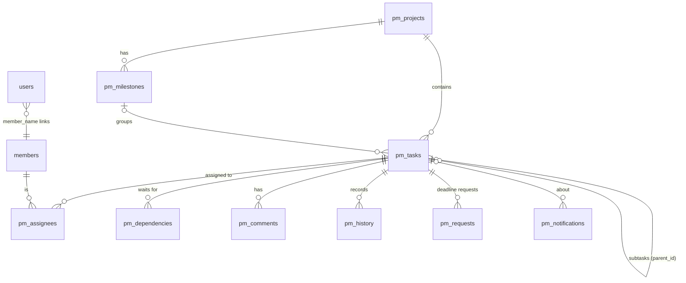

# TeamPulse 2.0: project management

TeamPulse 1.x watched a team's GitHub, Notion and Discord. TeamPulse 2.0 also lets the team **plan and run
the work inside TeamPulse**: projects, tasks, subtasks, dependencies, milestones, comments, deadline requests,
a personal workspace for every member and a dashboard for the team leader.

This document covers the decisions behind it, what phase 1 delivers, and the plan for the rest.

---

## 1. Decision: extend the current app, don't rewrite it

The spec asked whether to move to a new stack (for example FastAPI + React + PostgreSQL). We extended the
existing Streamlit + SQLite app instead.

| | Extend (chosen) | Rewrite (FastAPI + React + Postgres) |
|---|---|---|
| Existing features (conflicts, Hinglish blockers, contributions, Ask, guardrails, evaluation) | Keep working, already tested (191 tests) | Re-implemented or wrapped; weeks of risk |
| Security already audited (sessions, RBAC, rate limits, audit log, XSS) | Reused as-is | Rebuilt and re-audited |
| Cost | Free: Streamlit Community Cloud, one SQLite file | Needs hosting for an API, a frontend and a database |
| Team size it serves | 3–8 students, low concurrency | Hundreds of users |
| Drag-and-drop Kanban, real-time updates | Not native (status changes through a form; pages refresh on every action) | Native |
| Time to first usable version | One round | Several rounds before parity |

**Why this is enough.** Student teams are small. SQLite in WAL mode handles their write volume comfortably,
and the code already uses one connection per thread with a 15-second busy timeout. Every new write is a short
transaction. Two people editing the same task can't overwrite each other silently: each task carries a
`version`, and a save based on an old version is refused with "Someone else changed this task… reload".

**When to revisit.** Move to PostgreSQL (and a separate API) if TeamPulse ever hosts many teams in one
deployment, needs live collaborative editing, or outgrows one machine. All database access for project
management goes through `teampulse/pm.py`, so that move would touch one module.

## 2. MCP assessment

The Model Context Protocol (MCP) lets an AI assistant call tools on a server. We looked at it in two directions.

- **TeamPulse as an MCP client** (reading GitHub, Notion and Discord through their MCP servers instead of their
  REST APIs). Not worth it now. The pollers already work, are tested offline, retry on failure and respect
  consent. MCP would add a moving part without new data.
- **TeamPulse as an MCP server** (letting Claude Desktop or another assistant ask "what's blocked?" or "what's
  on my plate?"). Useful later. It would expose the same read functions the pages use (`pm.workspace`,
  `pm.dashboard`, the Ask supervisor) behind the same permission checks, with a per-user token. That fits
  phase 4, together with the AI project manager, and is listed there.

Decision: no MCP in phase 1. The functions an MCP server would call are designed for it: each takes the
signed-in person and checks permission itself.

## 3. What phase 1 delivers

**Projects and milestones.** The leader creates projects with dates and milestones.

**Tasks.** Each has a title, description, project, milestone, one or more assignees, the creator, priority
(low, medium, high, urgent), status, created / start / deadline / completed dates, an estimate in hours,
subtasks (one level), dependencies on other tasks in the project, comments and a full change history.
Archiving removes a task from every view but keeps its history.

**Workflow.** Backlog → To do → In progress → Under review → Completed, with Blocked available from any
state. The rules are enforced on the server:

- A task can't be started, sent for review or completed while a task it **waits for** is unfinished.
- **Blocked** needs a reason. The reason is saved as a blocker comment and the leader is notified.
- **Completed** is the leader's call. Members send finished work to Under review; the leader approves it or
  sends it back with a note. A task with open subtasks can't be completed.
- Only the leader can reopen completed work.

**Reported vs measured progress.** The assignee reports a percentage. TeamPulse also measures one: the share
of subtasks that are done, and 100% once the leader has completed the task. The spec calls the second one
"verified" progress. When the reported number runs 40 points or more ahead of the measured one, the task is
flagged ("reported 80% but only 33% of subtasks are done"). The flag describes the work, never the person.

**My work (each member's personal section).** Every member has their own page. It shows:

- counts: open, in progress, overdue, due in 7 days, blocked, completed (and completed this week)
- overall progress and estimated hours still open
- notifications
- **Focus** tab: overdue, blocked, due soon, high priority, open subtasks
- **All tasks** tab: in progress, to do and backlog, under review, completed, recently updated
- **Requests** tab: their deadline requests and what was decided

Members see only their own workspace. The leader can open anyone's, read-only for their inbox.

**Project board.** Every task in a project as a six-column board or a sortable list. You can filter by
assignee, priority and "only my tasks", and search. Opening a task shows its detail panel with the actions
you're allowed to take.

**Team dashboard (leader).** Shows:

- totals, completion %, in progress, under review, blocked, overdue
- **Needs your decision**: finished work to approve and deadline requests to approve or decline
- **At risk**: overdue, blocked, nearly due and under half done, waiting on unfinished work, a reported/measured
  gap, or nobody assigned
- **Workload**: open, in progress, blocked, overdue, completed and estimated hours per person, in alphabetical
  order. It's a workload view, not a ranking.
- upcoming milestones and recent activity

**Notifications** (in the app). They cover:

- being assigned or unassigned
- deadline changes
- comments on your tasks and @mentions
- your deadline request decided
- your work approved or sent back
- for leaders: blockers, work ready for review, and deadline requests

You never get notified about your own actions.

## 4. Permission matrix

Checked in `teampulse/pm.py` on every call, before anything is written. Refusals are written to the audit log.

| Action | Team leader | Assignee (member) | Other member |
|---|---|---|---|
| See My work, Project board, task details | ✅ (anyone's workspace) | ✅ (own workspace) | ✅ (own workspace) |
| Team dashboard | ✅ | ❌ | ❌ |
| Create project, milestone, task | ✅ | ❌ | ❌ |
| Edit title, description, priority, dates, estimate, milestone | ✅ | ❌ | ❌ |
| Assign and reassign, set dependencies | ✅ | ❌ | ❌ |
| Move status: Backlog / To do / In progress / Under review / Blocked | ✅ | ✅ | ❌ |
| Mark Completed, reopen | ✅ | ❌ (send for review) | ❌ |
| Update reported progress | ✅ | ✅ | ❌ |
| Add and tick subtasks | ✅ | ✅ (no deadlines or assignees on them) | ❌ |
| Report a blocker | ✅ | ✅ | ❌ |
| Request a deadline change | n/a (edits directly) | ✅ | ❌ |
| Approve or decline deadline requests | ✅ | ❌ | ❌ |
| Comment, @mention | ✅ | ✅ | ✅ |
| Archive a task | ✅ | ❌ | ❌ |

New permissions are `pm.manage` (leaders) and `pm.work` (everyone). Accounts not linked to a team member, and
accounts that still have to choose a password, can't change anything. Each person can make 120 project
changes per 10 minutes. That stops a runaway script or a public-demo visitor from flooding the board.

## 5. Data model

- `pm_tasks.version` is used for optimistic locking.
- `archived` soft-deletes a task.
- Status and priority are restricted by CHECK constraints, and progress must be 0–100.
- Notifications go to a member name, or to `@leaders` (one shared inbox for the team's leaders).
- The `tasks` table that TeamPulse rebuilds from GitHub and Notion is untouched. The page that shows it is now
  called **Source tasks**.

## 6. Tests

`tests/test_pm.py` (21 tests) covers:

- every leader-only action refused for members
- members limited to their own tasks
- the review and approval step
- unlinked accounts and accounts that must change their password
- subtasks, shared tasks, blockers, dependencies (including cycles)
- input validation, deadline requests and notification privacy
- a stale edit refused
- 8 threads updating at once
- the rate limit
- workspace and dashboard contents
- risk wording, archiving and page access

`tests/test_pm_ui.py` (11 tests) drives the real pages as a member and as the leader:

- a member's workspace shows only their tasks
- the leader switches between workspaces
- a member updates their task
- a member can comment on, but not change, someone else's task
- members don't see planning controls or the dashboard
- the leader creates a task, approves a deadline request and approves finished work
- hostile titles, comments and notifications never render as HTML on any of the three pages

## 7. Roadmap (later rounds)

| Phase | Contents |
|---|---|
| 2. Views and collaboration | Calendar and timeline (Gantt) views, task links (URLs), file attachments as links, edit and delete own comments, email digest of notifications, drag-and-drop board (needs a custom component) |
| 3. Sync | Link a planned task to a GitHub issue or Notion page. Show the source's status next to TeamPulse's and raise a conflict when they differ. Pre-fill tasks from existing issues. Count linked commits and PRs as evidence in measured progress. |
| 4. AI project manager | Turn a goal or meeting notes into proposed tasks, subtasks and deadlines. Nothing is created until the leader confirms. A task assistant ("what should I do next?", "write an update for my task"). TeamPulse as an MCP server. |
| 5. Proactive monitoring | Daily check for slipping tasks, overloaded people and stale blockers. It suggests; it never changes a task by itself. Weekly summary for the leader. |
